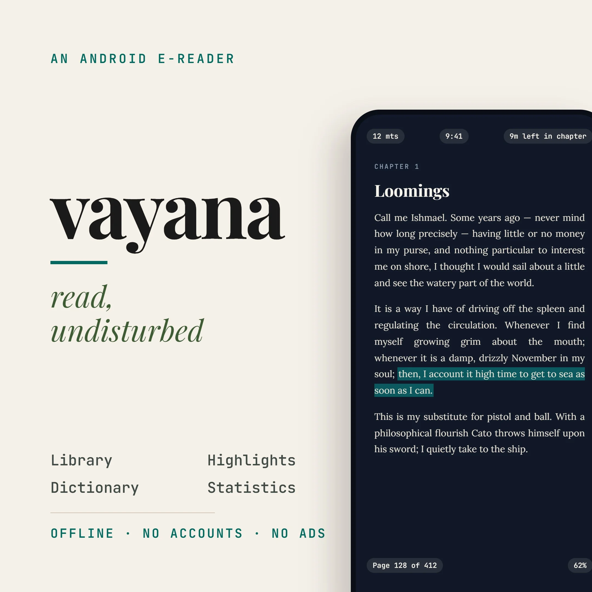
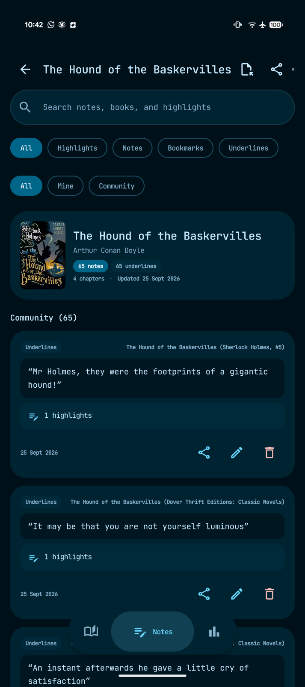
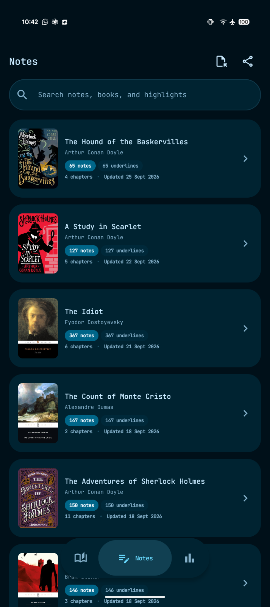
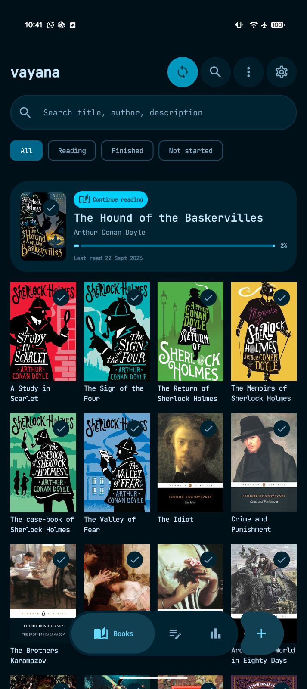
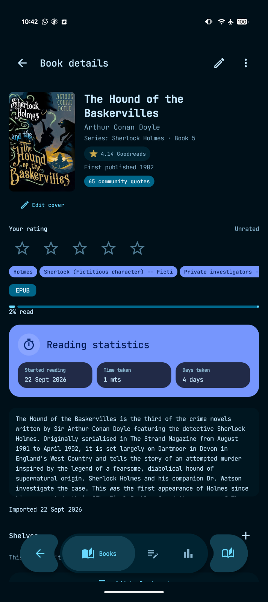

<div align="center">
  <picture>
    <source media="(prefers-color-scheme: dark)" srcset="core/resources/src/main/res/drawable-nodpi/vayana_share_dark_reader.webp">
    <source media="(prefers-color-scheme: light)" srcset="core/resources/src/main/res/drawable-nodpi/vayana_share_light.webp">
    
  </picture>

  <h1>Vayana</h1>

  <p><strong>Ungestört lesen.</strong></p>
  <p>Ein ruhiger <a href="docs/USER_GUIDE.de.md#reading-epub-books">EPUB</a>- und <a href="docs/USER_GUIDE.de.md#reading-pdf-books">PDF</a>-Reader für Android, der lokale Speicherung bevorzugt und für herkömmliche Bildschirme sowie <a href="docs/USER_GUIDE.de.md#e-ink-and-accessibility">E‑Ink-Geräte</a> entwickelt wurde.</p>

  <p>
    <a href="https://github.com/rjwarrier/Vayana/releases/latest"><strong>Neueste Version herunterladen</strong></a> ·
    <a href="https://ranjithj.in/vayana/"><strong>Vayana-Website</strong></a> ·
    <a href="https://github.com/rjwarrier/Vayana/releases/tag/v0.93">Versionshinweise</a> ·
    <a href="docs/USER_GUIDE.de.md">Benutzerhandbuch</a> ·
    <a href="docs/FEATURES.md">Funktionsdokumentation</a> ·
    <a href="docs/GITHUB_SYNC_SETUP.md">GitHub-Synchronisierung einrichten</a>
  </p>

  <p>
    
    
    
    
  </p>

  <p><a href="https://www.buymeacoffee.com/ranjithj"></a></p>
</div>

[English](README.md) · [Español](README.es.md) · [Português (Brasil)](README.pt.md) · [Français](README.fr.md) · **Deutsch**

<a id="why-vayana"></a>

## Warum Vayana?

Die meisten Lese-Apps beschränken sich darauf, ein Buch anzuzeigen. Vayana versteht Lesen als zusammenhängende Tätigkeit: Organisiere deine geplante Lektüre, bleibe im Text vertieft, bewahre wichtige Stellen auf, lerne unbekannte Wörter, kehre zu Bedeutsamem zurück und nimm deinen Lesefortschritt sicher von Gerät zu Gerät mit.

Vayana verlangt dafür weder ein Vayana-Konto noch zeigt es Werbung beim Lesen. Deine Bibliothek bleibt standardmäßig lokal. Optionale Online-Funktionen wie die [Anreicherung mit Goodreads](docs/USER_GUIDE.de.md#book-details-and-reading-status) und die [selbst verwaltete GitHub-Synchronisierung](docs/USER_GUIDE.de.md#github-sync) bleiben unter deiner Kontrolle.

<a id="latest-source-updates"></a>

## Neu in 0.93

Version 0.93 bringt eine neu gestaltete **Statistik** (Woche, Monat, Jahr und Gesamt im Vergleich mit dem vorigen Zeitraum, Balken- oder Liniendiagramm, wann du liest, meistgelesene Bücher, Lesezeit pro synchronisiertem Gerät sowie gehörte und gelesene Zeit), **mehrere Offline-Wörterbücher**, die nach der Sprache des Buches gewählt werden (Open English WordNet, GCIDE, Olam Englisch→Malayalam, über 300 zweisprachige FreeDict-Wörterbücher oder eigene StarDict-Dateien), und einen Bereich **Lernen**, der nur bewusst nachgeschlagene echte Wörter behält und ihre Bedeutungen zeigt. Siehe die [Änderungen seit v0.92](docs/releases/v0.93.md).

Version **v0.93** enthält signierte APKs für Smartphone und Wear OS. Installiere `Vayana-v0.93.apk` auf dem Smartphone und `Vayana-WearOS-v0.93.apk` auf der Uhr; siehe [Wear-OS-Einrichtung](docs/WEAR_OS.md#install-and-build). Die Uhr erfasst Lesesitzungen für gedruckte Bücher; sie zeigt keine EPUB- oder PDF-Bücher an.

## Highlights

- **[Ein echter E‑Ink-Modus](docs/USER_GUIDE.de.md#e-ink-and-accessibility):** keine Animation, Hardware-Blättertasten, seitenweise App-Bildschirme, getaktete Komplettaktualisierungen und eine Monochrom- oder Farbpalette für E‑Ink-Displays.
- **[Lesen, das zum Lernen wird](docs/USER_GUIDE.de.md#dictionary-translation-and-vocabulary):** Tippe zweimal auf ein Wort für Offline-Definitionen aus Wörterbüchern, die nach der Sprache des Buches gewählt werden, auch mit der Bedeutung in deiner Sprache; behalte die Wörter, die du wirklich nachschlagen wolltest, wiederhole sie in Abständen und exportiere sie nach Anki.
- **[Synchronisierung nach deinen Regeln](docs/USER_GUIDE.de.md#github-sync):** kein Vayana-Konto. Positionen, Sitzungen, Notizen, Bücher und Cover laufen über ein GitHub-Repository, das dir gehört; Bücher und Cover sind mit deiner Passphrase verschlüsselt.
- **[Eine Bibliothek für jedes Buch](docs/USER_GUIDE.de.md#offline-physical-borrowed-and-other-books):** EPUB und PDF neben gedruckten, geliehenen und Hörbüchern, mit Seitenverfolgung, Rückgabe-Erinnerungen und einer [Wear-OS-Begleit-App](docs/WEAR_OS.md), die das Lesen auf Papier am Handgelenk misst.
- **[Statistik, die etwas aussagt](docs/USER_GUIDE.de.md#statistics-and-goals):** wie diese Woche, dieser Monat oder dieses Jahr im Vergleich zum vorigen abschneidet, wann du liest, welche Bücher deine Zeit bekamen, wie viel du gehört hast und auf welchem Gerät.
- **[Vorlesen, das dem Text folgt](docs/USER_GUIDE.de.md#read-aloud):** Satz für Satz mit markierten Wörtern, natürlichen Pausen, Aussprache pro Buch und Zuhören, das auch bei ausgeschaltetem Bildschirm weiterzählt.
- **[Kostenlose Bücher eingebaut](docs/USER_GUIDE.de.md#adding-books):** lade aus Project Gutenberg oder deinen OPDS-Katalogen (Calibre, Calibre-Web, Standard Ebooks) und ergänze Bücher mit Goodreads-Details und -Zitaten.

## Bildschirmfotos

<table>
  <tr>
    <td width="50%" align="center">
      <br>
      <sub><a href="docs/USER_GUIDE.de.md#highlights-notes-bookmarks-and-quotes"><strong>Markierungen und Notizen</strong></a>: suchen, filtern, bearbeiten, teilen und persönliche Anmerkungen von Community-Zitaten unterscheiden.</sub>
    </td>
    <td width="50%" align="center">
      <br>
      <sub><a href="docs/USER_GUIDE.de.md#notes-library"><strong>Notizbibliothek</strong></a>: Anmerkungen nach Buch durchsuchen und Kapitel- sowie Notizanzahl auf einen Blick sehen.</sub>
    </td>
  </tr>
  <tr>
    <td width="50%" align="center">
      <br>
      <sub><a href="docs/USER_GUIDE.de.md#managing-the-library"><strong>Bibliothek</strong></a>: weiterlesen, suchen und eine coverorientierte Sammlung filtern.</sub>
    </td>
    <td width="50%" align="center">
      <br>
      <sub><a href="docs/USER_GUIDE.de.md#book-details-and-reading-status"><strong>Buchdetails</strong></a>: Metadaten, Community-Zitate, persönliche Bewertung, Fortschritt und Lesestatistiken an einem Ort.</sub>
    </td>
  </tr>
</table>

<a id="what-makes-it-different"></a>

## Was Vayana besonders macht

<a id="a-real-eink-mode"></a>

### [Ein echter E‑Ink-Modus](docs/USER_GUIDE.de.md#e-ink-and-accessibility)

E‑Ink ist ein eigenständiges Anzeigeprofil statt eines bloßen Farbfilters:

- Kontinuierliche Bewegung wird entfernt; die wellenförmige Lesefortschrittslinie bleibt statisch.
- Die Animation beim Umblättern ist deaktiviert, und die Uhr im Reader wird nur beim Seitenwechsel aktualisiert.
- Wähle **Monochrom** oder **Farbe** unter **Einstellungen → Darstellung → E-Ink-Palette** oder bei der Ersteinrichtung. Monochrom bleibt der Standard: Cover erscheinen in kontrastreichen Graustufen, Markierungen als schwarze Zeichen mit unterschiedlichen Formen. Farbe erhält Cover, Illustrationen, Markierungen und Themenakzente auf farbigen E-Ink-Displays.
- Beide Paletten bewahren das E-Ink-Verhalten für Bewegung, Seitenwechsel und Aktualisierung; Farbunterstützung schaltet Animationen nicht wieder ein.
- Farbiges E-Ink nutzt eine eigene kontrastreiche Palette: neutrale Flächen, schwarzer/weißer Text, durchgezogene Umrisse sowie blaugrüne, blaue und bordeauxfarbene Akzente. Hell und Dunkel werden unterstützt; Hintergrundbildfarben und OLED-Flächenvarianten werden in diesem Profil übersprungen. Cover und gewählte Seitenthemen bleiben erhalten. Digitale Kontrastprüfungen ersetzen keine Tests auf dem Display mit seiner Frontbeleuchtung und seinen Aktualisierungseinstellungen.
- Physische Seitentasten blättern im Reader und bewegen durch lange App-Bildschirme.
- Bibliothek, Notizen, Suche, Einstellungen, Regale und Statistiken erhalten Steuerelemente zum Weiterblättern um jeweils eine Bildschirmhöhe.
- Bereinigende Display-Aktualisierungen können nach einer gewählten Seitenzahl und bei Kapitel- oder Menüwechseln erfolgen.
- Typografieoptionen umfassen kräftigeren Text, Ausrichtung und Silbentrennung.

<a id="reading-that-becomes-learning"></a>

### [Lesen, das zum Lernen wird](docs/USER_GUIDE.de.md#dictionary-translation-and-vocabulary)

- Tippe zweimal auf ein Wort für eine Offline-Definition. Vayana wählt Wörterbücher nach der Sprache des Buches und kann die Bedeutung in deiner Sprache ergänzen: Installiere Open English WordNet, GCIDE (Webster 1913), Olam Englisch→Malayalam, eines von über 300 zweisprachigen FreeDict-Wörterbüchern oder deine eigene StarDict-Datei. Fehlende Wörter lassen sich mit einem Tippen in Wiktionary oder Wikipedia nachschlagen.
- Nur bewusst nachgeschlagene echte Wörterbuchwörter landen in **Lernen**; tippe dort auf ein Wort, um seine Bedeutung zu sehen, oder entferne es.
- Speichere nachgeschlagene Wörter direkt in einer Sammlung zum Wiederholen in zeitlichen Abständen.
- Entdecke ungewöhnliche Wörter im aktuellen Kapitel mit ihren Definitionen.
- Exportiere Vokabeln als Anki-kompatible CSV oder lesbares Markdown.
- Wiederhole deine Markierungen in zeitlichen Abständen: **Bald wiedersehen**, **Verstanden** oder **Gut bekannt**.
- Nach einer Pause zeigt ein Rückblick eine aktuelle Markierung und fällige Vokabeln.

<a id="read-aloud-that-follows-the-book"></a>

### [Vorlesen, das dem Buch folgt](docs/USER_GUIDE.de.md#read-aloud)

- Android-Sprachausgabe liest Satz für Satz und wechselt zwischen Kapiteln.
- Gesprochene Wörter oder Sätze werden direkt im Text markiert.
- Starte an einer ausgewählten Stelle; tippe irgendwo in den Reader, um zu pausieren.
- Wähle die installierte TTS-Engine, Stimme, Geschwindigkeit und Tonhöhe und bring ihr bei, wie Namen und Wörter in jedem Buch ausgesprochen werden.
- Natürliche Pausen zwischen Sätzen, Absätzen und Szenen; Zahlen, Daten und römische Zahlen werden so gelesen, wie sie gemeint sind.
- Das Vorlesen läuft bei ausgeschaltetem Bildschirm weiter und zählt als Lesezeit.
- Nutze einen Abschalttimer, Audiofokus-Verwaltung, Kopfhörer-/Bluetooth-Steuerung, Sperrbildschirmsteuerung und Benachrichtigungsaktionen.

<a id="sync-without-a-proprietary-service"></a>

### [Synchronisierung ohne proprietären Dienst](docs/USER_GUIDE.de.md#github-sync)

Nutze ein GitHub-Repository unter deiner Kontrolle, um Folgendes zu synchronisieren:

- Leseposition, Sitzungen und Lesedaten
- Bücher, Cover und Bibliotheksmetadaten
- Markierungen, Notizen, Regale und Als Nächstes lesen
- Vokabeln, nachgeschlagene Wörter und übertragbare Einstellungen
- Home-Library-Bücher und ihre Lesedaten
- Löschungen und Wiederherstellungen zwischen Geräten

Buch- und Coverdateien werden vor dem Hochladen mit AES-GCM und deiner Passphrase verschlüsselt. Eine leichte Fortschrittssynchronisierung kann während des Lesens laufen; Konfliktmeldungen nennen die neuere Position mit Synchronisierungszeit und Gerätename. Die Synchronisierungskonfiguration lässt sich als verschlüsselte Übertragungsdatei für ein anderes Gerät exportieren. Hochgeladen wird nur, was sich geändert hat; eine Synchronisierung ohne Neues dauert etwa eine Sekunde, und **Einstellungen → Hilfe & Info → Datennutzung** zeigt, was jede Synchronisierung gesendet und empfangen hat.

Folge der [Schritt-für-Schritt-Anleitung zur GitHub-Synchronisierung](docs/GITHUB_SYNC_SETUP.md), um ein privates Repository anzulegen, ein Token mit minimalen Berechtigungen einzurichten, das erste Gerät zu verbinden und weitere sicher hinzuzufügen.

<a id="features"></a>

## Funktionen

| Bereich | Highlights |
| --- | --- |
| [**Bibliothek**](docs/USER_GUIDE.de.md#managing-the-library) | EPUB/PDF-Import, Ordnersuche, Android **Öffnen mit**, Duplikaterkennung, Raster-/Listenansicht, Filter, Sortierung, aktuelle Lektüre, Als Nächstes lesen, Regale, Serienordner und Kürzlich gelöscht |
| [**Bücher ohne digitale Datei und gedruckte Bücher**](docs/USER_GUIDE.de.md#offline-physical-borrowed-and-other-books) | Erfassung ohne lokale Datei, Fortschritt und Zeitmesser, Status eigenes/ausgeliehenes Buch, Rückgabedaten und Erinnerungen; optionale Spiegelung des von Home Library geteilten Katalogs |
| [**Buchdetails**](docs/USER_GUIDE.de.md#book-details-and-reading-status) | Bearbeitbare Metadaten, Serien und Tags, Bewertungen, Lesedaten, Zeitaufwand, eigene Cover, Austausch der Quelldatei, Dateifreigabe und visuelle Lesekarten |
| [**Goodreads**](docs/USER_GUIDE.de.md#book-details-and-reading-status) | Vorschau und Import von Seriendaten, Genres, Beschreibung, Cover, Erscheinungsjahr, Bewertung und beliebten Zitaten; Browseralternative bei blockiertem Direktabruf |
| [**Bücher entdecken**](docs/USER_GUIDE.de.md#adding-books) | Project Gutenberg nach Thema oder Sprache durchsuchen und Bücher herunterladen sowie OPDS-Kataloge wie Calibre, Calibre-Web und Standard Ebooks verbinden |
| [**EPUB-Reader**](docs/USER_GUIDE.de.md#reading-epub-books) | Inhaltsnavigation, gespeicherte Position, Einstellungen pro Buch, importierte Schriften, Themen, Ränder, Kopf-/Fußzeilen, Verlagsstile, Tippzonen, Lautstärketasten, Vollbild und zwei Spalten im Querformat |
| [**PDF-Reader**](docs/USER_GUIDE.de.md#reading-pdf-books) | Seiten- und Gliederungsnavigation, Anpassung/Zoom, Textauswahl, Wörterbuch, Markierungen, Unterstreichungen, Notizen, Lesezeichen, Kopieren und Zitatkarten für Text-PDFs |
| [**Typografie**](docs/USER_GUIDE.de.md#typography-and-page-appearance) | Schriftfamilie und -größe, Zeilenhöhe, eigene Schriften, Ausrichtung, Silbentrennung, kräftigerer Text und optionales bionisches Lesen |
| [**Anmerkungen**](docs/USER_GUIDE.de.md#highlights-notes-bookmarks-and-quotes) | Markierungen, Unterstreichungen, Lesezeichen, Notizen, Anmerkungs-Tags, Zusammenführen überlappender Markierungen, Fußnoten-Pop-ups und direkter Sprung zur Textstelle |
| [**Notizen und Zitate**](docs/USER_GUIDE.de.md#notes-library) | Globale und buchbezogene Notizansichten, Kindle-Import von `My Clippings.txt`, Markdown-Export, Goodreads-Zitatimport und teilbare Zitatkarten als Bilder |
| [**Wörterbuch und Übersetzung**](docs/USER_GUIDE.de.md#dictionary-translation-and-vocabulary) | Mehrere Offline-Wörterbücher (WordNet, GCIDE, Olam Englisch→Malayalam, über 300 zweisprachige FreeDict-Wörterbücher, StarDict-Import), gewählt nach der Sprache des Buches, mit Bedeutungen in deiner Sprache; Wendungssuche, Wiktionary/Wikipedia als Alternative, Übersetzung, gespeicherte Vokabeln, Lernwörter mit Bedeutungen, Kapitelwörter, Wiederholung in Abständen, bekannte Wörter und Anki-/Markdown-Export |
| [**Vorlesen**](docs/USER_GUIDE.de.md#read-aloud) | Satzbegleitende Android-TTS mit Kapitelwechsel, Start an der Auswahl, natürlichen Pausen, Aussprache pro Buch, Abschalttimer, Stimme/Geschwindigkeit/Tonhöhe, Audiofokus, Kopfhörer/Bluetooth und Benachrichtigungssteuerung; Zuhören zählt als Lesezeit, auch bei ausgeschaltetem Bildschirm |
| [**Suche**](docs/USER_GUIDE.de.md#search) | Volltextsuche in Buchtext, Metadaten, Markierungen, Notizen und Kapitelnamen; exakte Wendungen in Anführungszeichen, Ergebnisse nach Buch oder Regal eingrenzbar, Präfixsuche und letzte Suchen |
| [**Statistiken**](docs/USER_GUIDE.de.md#statistics-and-goals) | Woche, Monat, Jahr und Gesamt im Vergleich mit dem vorigen Zeitraum, Balken- oder Liniendiagramme, wann du liest (Tageszeit, Wochentag, Sitzungslänge), meistgelesene Bücher, Lesezeit pro synchronisiertem Gerät, gehörte und gelesene Zeit, Leseserien, tägliche/jährliche Ziele, gelesene Bücher, Aktivität nach Datum, Verlauf pro Buch und Speicherverbrauch auf dem Gerät |
| [**Wear-OS-Begleit-App**](docs/USER_GUIDE.de.md#wear-os-companion) | Offline-Timer und Seitenverfolgung für gedruckte Bücher auf der Uhr, gemeinsame Timersteuerung auf Smartphone und Uhr, Leseziele, eine Kachel und eine Zifferblatt-Komplikation |
| [**Widgets und Verknüpfungen**](docs/USER_GUIDE.de.md#widgets-and-app-shortcuts) | Weiterlesen mit Vorlesen/Wiedergabepause, anpassbares Sieben-Tage-Lesezeitdiagramm und Verknüpfungen zu wichtigen Bibliotheksbereichen |
| [**Sicherung**](docs/USER_GUIDE.de.md#backup-and-restore) | Manuelle Sicherung/Wiederherstellung als übertragbares ZIP und automatische Sicherungen in einem gewählten Ordner, täglich, wöchentlich oder alle 30 Tage, mit Aufbewahrungseinstellungen |
| [**Diagnose**](docs/USER_GUIDE.de.md#diagnostics-and-support) | Lokaler Absturz- und Synchronisierungsverlauf, Umgebungsdetails, Bereinigung sensibler Daten, Kopieren/Teilen und Entwickler-Support mit einem Tippen |
| [**Datenschutz und Daten**](docs/USER_GUIDE.de.md#privacy-and-online-services) | Ein Bildschirm „Datenschutz & Daten“, der zeigt, wo deine Daten liegen, was das Gerät verlässt und wie es um die Gerätesicherheit steht; Datennutzung mit WLAN-/Mobilverkehr der App und was jede Synchronisierung gesendet hat |
| [**Sprachen**](docs/USER_GUIDE.de.md#settings-and-languages) | Sprachauswahl in der App für Englisch, Spanisch, Portugiesisch, Russisch, Deutsch, Französisch, Italienisch, Malayalam und Tamil |
| [**Darstellung**](docs/USER_GUIDE.de.md#settings-and-languages) | Material 3, System-/Hell-/Dunkelmodus, echtes Schwarz, optionale Material-You-Farben, Standard-/E‑Ink-Profile, Bewegungseinstellungen und adaptive Smartphone-/Tablet-Navigation |

Vayana kann auch [gedruckte und ausgeliehene Bücher erfassen](docs/USER_GUIDE.de.md#offline-physical-borrowed-and-other-books), ohne digitale Datei, einschließlich Fortschritt, Daten, Bewertungen, Notizen und Statistiken.

<a id="install"></a>

## Installation

Vayana unterstützt **Android 8.0 (API 26) und neuer**.

Eine Einführung in die erste Nutzung findest du im [Schnellstart](docs/USER_GUIDE.de.md#quick-start).

1. Öffne die [neueste GitHub-Veröffentlichung](https://github.com/rjwarrier/Vayana/releases/latest).
2. Lade `Vayana-v0.93.apk` herunter.
3. Erlaube bei Nachfrage die Installation aus deinem Browser oder Dateimanager und öffne die APK.

Android kann warnen, dass die App nicht aus Google Play stammt. Die Versionsdateien enthalten eine `.sha256`-Datei, mit der sich der Download vor der Installation prüfen lässt.

Für v0.93:

```text
APK-SHA-256
6C1F1F8517303367CCCACBD23909312718092268769AFAA731832FBB5B815197

SHA-256 des Signaturzertifikats
53:2C:F4:07:D5:F0:D1:21:58:8A:5C:F1:6E:61:12:C8:F1:BB:3B:7E:D9:CF:F1:39:80:6A:7B:63:C6:43:96:C7
```

<a id="current-scope"></a>

## Aktueller Umfang

- **Lesbare E-Book-Formate:** [EPUB](docs/USER_GUIDE.de.md#reading-epub-books) und [PDF](docs/USER_GUIDE.de.md#reading-pdf-books). Gescannte PDFs ohne Textebene unterstützen Anzeige, Zoom und Lesezeichen, aber keine Textauswahl. [Gedruckte Bücher](docs/USER_GUIDE.de.md#offline-physical-borrowed-and-other-books) lassen sich ohne Datei erfassen.
- **Online-Zugriff:** Grundlegendes Lesen, Notizen, Wörterbuch und Statistiken funktionieren lokal. [Project Gutenberg](docs/USER_GUIDE.de.md#download-free-books-from-project-gutenberg), [OPDS](docs/USER_GUIDE.de.md#connect-an-opds-catalog), Goodreads-Anreicherung, Coversuche, Übersetzung, Wiktionary/Wikipedia-Abfragen, Wörterbuch-Downloads und [GitHub-Synchronisierung](docs/USER_GUIDE.de.md#github-sync) benötigen bei Nutzung Internet; ausgewählter Text wird nur dann an einen Anbieter gesendet, wenn du diese Aktion wählst. Siehe [Datenschutz und Online-Dienste](docs/USER_GUIDE.de.md#privacy-and-online-services).
- **E‑Ink-Aktualisierung:** [Geräteübergreifendes E‑Ink-Verhalten](docs/USER_GUIDE.de.md#e-ink-display-profile) ist implementiert. Herstellerspezifische Aktualisierungsmodi wie Onyx-/Boox-SDK-Modi sind noch nicht integriert.
- **Cloud-Verlauf:** Dauerhaft gelöschte verschlüsselte Dateien können in älteren Commits des GitHub-Synchronisierungs-Repositorys verbleiben, da der Git-Verlauf unveränderlich ist, solange er nicht neu geschrieben wird. Siehe [aktuelle Einschränkungen](docs/USER_GUIDE.de.md#current-limitations).

<a id="build-from-source"></a>

## Aus dem Quellcode erstellen

<a id="requirements"></a>

### Voraussetzungen

- JDK 17 oder neuer
- Android SDK 37
- Git

Klone das Repository und erstelle mit dem enthaltenen Gradle-Wrapper eine Debug-APK:

```bash
git clone https://github.com/rjwarrier/Vayana.git
cd Vayana
./gradlew :app:assembleDebug
```

Unter Windows:

```powershell
.\gradlew.bat :app:assembleDebug
```

Die Debug-APK liegt unter `app/build/outputs/apk/debug/`.

Um auch die Begleit-App zu erstellen, führe `./gradlew :app:assembleDebug :wear:assembleDebug` aus
(oder `.\gradlew.bat :app:assembleDebug :wear:assembleDebug` unter Windows).
Installiere `wear/build/outputs/apk/debug/wear-debug.apk` auf der Uhr. Beide Apps müssen
dasselbe Signaturzertifikat nutzen; siehe [Installation und Prüfung](docs/WEAR_OS.md#install-and-build).

<a id="release-signing"></a>

### Veröffentlichung signieren

Zugangsdaten für Veröffentlichungen bleiben außerhalb von Git. Verweise mit `VAYANA_KEYSTORE_PROPERTIES` als Gradle-Eigenschaft oder Umgebungsvariable auf eine lokale Java-Properties-Datei:

```properties
storeFile=/absolute/path/to/release-keystore
storePassword=...
keyAlias=...
keyPassword=...
storeType=PKCS12
```

```bash
./gradlew :app:assembleRelease \
  -PVAYANA_KEYSTORE_PROPERTIES=/absolute/path/to/keystore.properties
```

Ohne externen Pfad sucht der Build im Repository-Stamm nach einer von Git ignorierten `keystore.properties`-Datei.

<a id="project-structure"></a>

## Projektstruktur

```text
app/                    Smartphone-Anwendungsrahmen und Navigation
wear/                   Wear-OS-Begleit-App für gedruckte Bücher
core/wear/              Gemeinsamer Zeitmesser, Sitzungen und Data-Layer-Protokoll
core/                   Datenbank, Einstellungen, Dateien, Sicherung, Synchronisierung, Diagnose, Home-Library-Integration und Designsystem
feature/                Bibliothek, Reader, Entdeckung, Notizen, Erinnerungen, Suche, Statistiken, Einstellungen und Ersteinrichtung
reader/engine-api/      Schnittstellenvertrag des Lesemotors
reader/engine-web/      Foliate-basierter EPUB-Motor und WebView-Brücke
format/epub/            EPUB-Metadaten und Import
format/pdf/             PDF-Metadaten, Darstellung und Text
format/convert/         Gemeinsame Dokumentkonvertierung
dictionary/             Wörterbuch-API, Offline-Wörterbücher (WordNet, GCIDE, Olam, FreeDict/StarDict) und Online-Nachschlagen
build-logic/            Gemeinsame Android- und Kotlin-Build-Konventionen
```

Die App verwendet Kotlin, Jetpack Compose, Material 3, Room, DataStore, Hilt, WorkManager und eine gezielte Einbindung des EPUB-Darstellungssystems von Foliate.

<a id="documentation"></a>

## Dokumentation

- [Vayana-Website](https://ranjithj.in/vayana/)
- [Benutzerhandbuch und ausführliche Funktionshilfe](docs/USER_GUIDE.de.md)
- [Dokumentationsübersicht](docs/README.md)
- [Funktionsverhalten und Invarianten](docs/FEATURES.md)
- [Einrichtung und Nutzung der Wear-OS-Begleit-App](docs/WEAR_OS.md)
- [Änderungen seit v0.92](docs/releases/v0.93.md)
- [GitHub-Synchronisierung einrichten](docs/GITHUB_SYNC_SETUP.md)
- [Architektur- und Implementierungsentscheidungen](docs/DECISIONS.md)
- [Datenbank-Änderungsverlauf](docs/DATABASE_CHANGELOG.md)
- [Entwurf der GitHub-Synchronisierung](docs/GITHUB_SYNC_IMPLEMENTATION_PLAN.md)
- [Versionshinweise v0.93](https://github.com/rjwarrier/Vayana/releases/tag/v0.93)
- [Versionshinweise v0.85](docs/releases/v0.85.md)

<a id="feedback"></a>

## Rückmeldungen

Nutze [GitHub Issues](https://github.com/rjwarrier/Vayana/issues) für reproduzierbare Fehler und konkrete Funktionswünsche. Bei Reader- oder Synchronisierungsproblemen nenne Android-Version, Gerätemodell, Anzeigeprofil und, sofern verfügbar, den [Diagnoseexport](docs/USER_GUIDE.de.md#diagnostics-and-support); füge niemals ein GitHub-Token oder die Synchronisierungs-Passphrase hinzu.

<a id="support"></a>

## Unterstützung

Wenn Vayana dir hilft, kannst du die Entwicklung unterstützen:

<a href="https://www.buymeacoffee.com/ranjithj"></a>

## Lizenz

Vayana ist freie Software unter der [GNU General Public License, Version 3 oder neuer](LICENSE). Du darfst Vayana nutzen, verändern und weitergeben; veränderte Versionen müssen ebenfalls unter der GPL mit Quellcode veröffentlicht werden.
