

# Guía de usuario de Vayana

[English](USER_GUIDE.md) · **Español** · [Português (Brasil)](USER_GUIDE.pt.md) · [Français](USER_GUIDE.fr.md) · [Deutsch](USER_GUIDE.de.md) · [README en español](../README.es.md)

Esta guía describe las funciones disponibles en Vayana 0.93 y explica los procedimientos más habituales de lectura, biblioteca, copias de seguridad, sincronización y soporte. Vayana es un lector Android de EPUB y PDF centrado en el almacenamiento local. También registra libros físicos, prestados, audiolibros y otros libros sin archivo digital.

> **Versión 0.93:** Descarga ambos APK firmados desde la [página de la versión](https://github.com/rjwarrier/Vayana/releases/tag/v0.93) para la [aplicación complementaria Wear OS](WEAR_OS.md). Consulta las [notas de la versión](releases/v0.93.md) para ver los cambios desde v0.92.

> Las capturas de esta guía se tomaron en un dispositivo de desarrollo con libros de dominio público de Project Gutenberg. La distribución de la pantalla puede variar según su tamaño, la versión de Android, el tema, el idioma y los ajustes E-Ink.

## Contenido

- [Inicio rápido](#quick-start)
- [Navegación](#navigation)
- [Añadir libros](#adding-books)
- [Gestionar la biblioteca](#managing-the-library)
- [Detalles del libro y estado de lectura](#book-details-and-reading-status)
- [Leer libros EPUB](#reading-epub-books)
- [Leer libros PDF](#reading-pdf-books)
- [Resaltados, notas, marcadores y citas](#highlights-notes-bookmarks-and-quotes)
- [Diccionario, traducción y vocabulario](#dictionary-translation-and-vocabulary)
- [Lectura en voz alta](#read-aloud)
- [Búsqueda](#search)
- [Estadísticas y objetivos](#statistics-and-goals)
- [Aplicación complementaria Wear OS](#wear-os-companion)
- [Widgets y accesos directos](#widgets-and-app-shortcuts)
- [Copias de seguridad y restauración](#backup-and-restore)
- [Sincronización con GitHub](#github-sync)
- [E-Ink y accesibilidad](#e-ink-and-accessibility)
- [Ajustes e idiomas](#settings-and-languages)
- [Diagnóstico y soporte](#diagnostics-and-support)
- [Privacidad y servicios en línea](#privacy-and-online-services)
- [Solución de problemas](#troubleshooting)
- [Limitaciones actuales](#current-limitations)

## Inicio rápido

1. Instala el APK de la [última versión en GitHub](https://github.com/rjwarrier/Vayana/releases/latest).
2. Completa la configuración inicial y elige el perfil de pantalla adecuado: **Estándar** o **E-Ink**.
3. Abre **Libros** y toca **Añadir libros**.
4. Importa un EPUB/PDF, explora una carpeta o elige **Libros gratuitos** para navegar por Project Gutenberg.
5. Toca una portada para abrir **Detalles del libro** y elige **Continuar leyendo**.
6. Toca el centro de una página EPUB para mostrar las herramientas del lector y los controles de apariencia.

Vayana almacena la biblioteca localmente de forma predeterminada. No requiere una cuenta. Las copias de seguridad, la sincronización con GitHub, Goodreads, Project Gutenberg, OPDS, las descargas de diccionarios, las consultas Wikimedia y la traducción son opcionales.

<table>
  <tr>
    <td width="50%" align="center">
      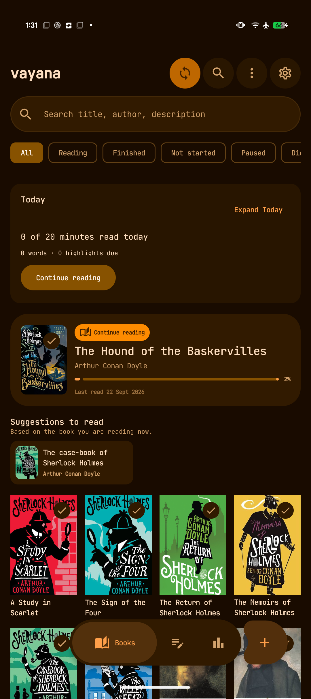 
      <strong>Biblioteca</strong>: estado de lectura, Continuar leyendo, sugerencias, filtros y portadas.
    </td>
    <td width="50%" align="center">
      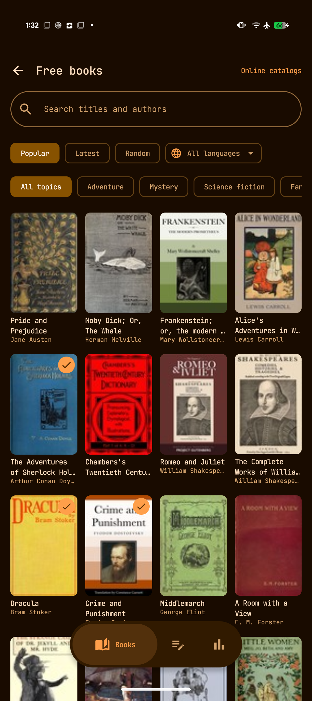 
      <strong>Libros gratuitos</strong>: explora títulos de dominio público por popularidad, tema o idioma.
    </td>
  </tr>
</table>

## Navegación

El diseño compacto para teléfonos tiene tres destinos principales:

- **Libros** abre el panel de lectura y la biblioteca.
- **Notas** agrupa resaltados, subrayados y notas por libro.
- **Estadísticas** muestra el tiempo de lectura por semana, mes, año o en total, rachas, objetivos, libros terminados, palabras que buscaste y uso de almacenamiento.

El botón **Añadir libros** aparece junto a la navegación principal. La barra de herramientas de la biblioteca también ofrece:

- **Sincronizar ahora** para la sincronización con GitHub configurada.
- **Buscar** en la biblioteca y los datos de lectura.
- **Más acciones de biblioteca** para vistas como Próximas lecturas, estanterías, libros sin archivo digital y Eliminados recientemente.
- **Ajustes** de apariencia, comportamiento del lector, copias de seguridad, sincronización, objetivos, Ayuda, Acerca de y Diagnóstico.

En pantallas grandes, Vayana usa diseños adaptables, navegación lateral y vistas de lista/detalle cuando el espacio lo permite. Se puede activar un diseño de lector/notas en dos columnas para pantallas anchas en horizontal.

## Añadir libros

### Importar archivos EPUB o PDF

Desde **Libros → Añadir libros**:

- **Importar libros** abre el selector de archivos de Android para elegir uno o varios EPUB/PDF.
- **Importar carpeta** explora una carpeta seleccionada e importa los libros compatibles que encuentre.
- **Abrir con** de Android y **Compartir con Vayana** permiten importar un archivo compatible desde otra aplicación.
- **Reemplazar origen**, en Detalles del libro, sustituye un archivo que falta o ha cambiado y conserva, cuando es posible, el registro de biblioteca y los datos de lectura de Vayana.

Vayana detecta posibles importaciones duplicadas. Mantén disponibles los archivos originales hasta que termine la importación. Los PDF protegidos con contraseña se indican como no compatibles.

### Descargar libros gratuitos de Project Gutenberg

Abre **Libros → Añadir libros → Libros gratuitos**. Puedes:

- Buscar por título o autor.
- Alternar entre las listas **Populares**, **Recientes** y **Aleatorios**.
- Filtrar por idioma y temas como aventura, misterio, ciencia ficción, fantasía, poesía o literatura infantil.
- Abrir un título, comparar ediciones disponibles y elegir versiones con o sin imágenes.
- Ver qué libros ya están en la biblioteca de Vayana.
- Seguir explorando un catálogo guardado en caché cuando Project Gutenberg no esté disponible temporalmente.

Los títulos de Project Gutenberg pueden estar libres de derechos de autor en Estados Unidos, pero no necesariamente en otros países. Comprueba las normas de derechos de autor de tu lugar de residencia.

### Conectar un catálogo OPDS

Elige **Catálogos en línea** en la pantalla Libros gratuitos. Añade la dirección OPDS proporcionada por un servicio como:

- Servidor de contenidos de Calibre
- Calibre-Web
- Standard Ebooks
- Otro catálogo OPDS compatible

Abre un catálogo para explorar sus fuentes de navegación, buscar si el servidor lo permite y descargar libros EPUB o PDF compatibles. La autenticación y la disponibilidad dependen del servidor del catálogo.

  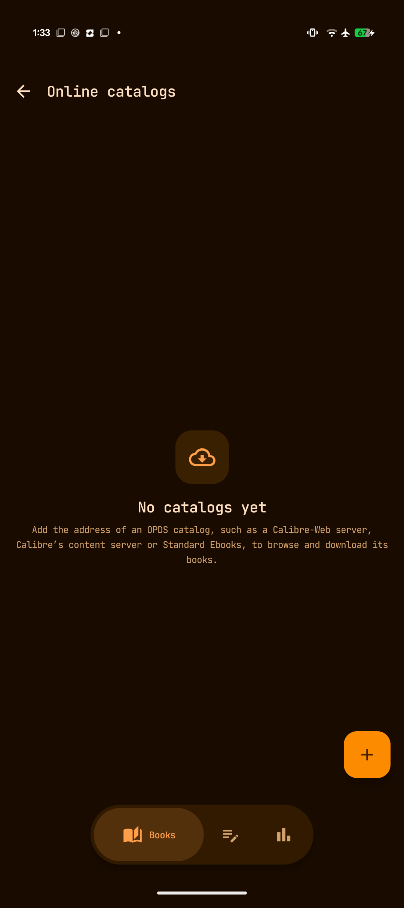 
  Añade Calibre, Calibre-Web, Standard Ebooks u otro catálogo OPDS.

## Gestionar la biblioteca

### Panel y filtros

La biblioteca combina el catálogo con un panel de lectura:

- **Hoy** muestra el avance hacia el objetivo diario de lectura y los repasos pendientes.
- **Continuar leyendo** vuelve al libro disponible localmente usado más recientemente.
- **Sugerencias de lectura** usa el contexto actual de la biblioteca para mostrar libros relacionados.
- Los filtros de estado incluyen **Todos**, **Leyendo**, **Terminados**, **Sin empezar**, **En pausa** y **No terminado**.
- La búsqueda encuentra coincidencias en título, autor y descripción.
- Las vistas de cuadrícula/lista, la ordenación, las estanterías, las series, Próximas lecturas y otros filtros ayudan a organizar bibliotecas grandes.

### Próximas lecturas, estanterías y series

- Añade libros a **Próximas lecturas** y reorganiza la cola.
- Crea estanterías para colecciones personales y filtros.
- Usa los metadatos de series para agrupar libros relacionados y conservar su orden.
- Un libro puede conservar etiquetas, valoración, fechas, progreso, notas y estadísticas de lectura junto con los metadatos del archivo.

### Libros sin archivo digital, físicos, prestados y otros

Los registros de libros sin archivo digital no requieren un EPUB ni un PDF. Úsalos para libros de papel, audiolibros o formatos leídos en otra aplicación. Puedes registrar:

- Título, autor, portada, serie, etiquetas y número de páginas
- Estado y fechas de lectura
- Páginas leídas o porcentaje de progreso
- Valoraciones, notas y sesiones de lectura
- Estado **Propio** o **Prestado**
- Fecha de devolución de libros prestados

Si se activan, los recordatorios de préstamo pueden avisar tres días antes, un día antes y el día de la devolución.

### Copia de Home Library

Si la aplicación Home Library del desarrollador está instalada en el mismo dispositivo y se permite compartir datos, Vayana puede reflejar ese catálogo en Libros sin archivo digital:

- Activa **Sincronizar con Home Library** en Ajustes.
- Los campos del catálogo reflejado son de solo lectura; Home Library sigue siendo responsable de esos datos.
- Vayana conserva su propio progreso, fechas, estado de Próximas lecturas, notas y estadísticas.
- La ubicación en la estantería y los metadatos compartidos aparecen en la búsqueda y en Detalles del libro.
- **Ver en Home Library** vuelve al registro original.

## Detalles del libro y estado de lectura

Detalles del libro reúne los metadatos y la actividad de lectura. Según el libro, puede mostrar:

- Portada, título, autor, serie, formato y progreso
- Descripción, datos editoriales, etiquetas, temas y metadatos personalizados
- Valoración personal y estado de lectura
- Fechas de inicio, finalización y última lectura
- Tiempo de lectura y progreso actual
- Notas, resaltados, citas y recuentos de capítulos
- Acciones de archivo, sustitución del origen, compartir y edición de portada
- Metadatos, valoración, géneros, datos de series y citas de la comunidad de Goodreads, de forma opcional

Los cambios de metadatos y portada afectan al registro local de Vayana, salvo que el libro sea una copia de solo lectura de Home Library.

  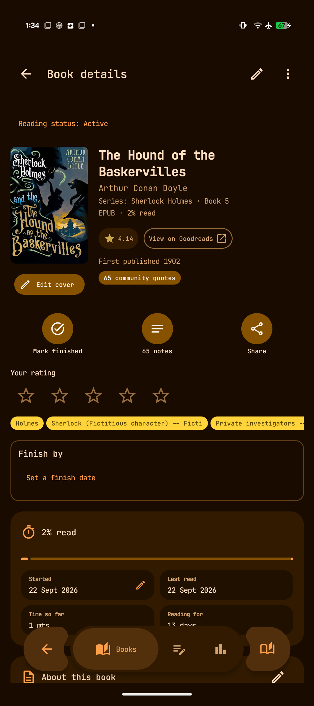 
  Detalles del libro combina metadatos, estado, progreso, fechas, notas y acciones.

## Leer libros EPUB

El lector EPUB de Vayana recuerda la posición de cada libro y admite texto reajustable, EPUB de diseño fijo y opciones de presentación por libro.

### Navegación del lector

- Toca o desliza para cambiar de página según las zonas de toque y el comportamiento configurados.
- Usa las teclas físicas de volumen/página cuando estén activadas.
- Abre **Índice** para ir a un capítulo.
- Añade marcadores y vuelve a ellos.
- Busca en el libro actual.
- Consulta el progreso por página/posición y porcentaje.
- Configura pantalla completa, información de encabezado/pie y mantener la pantalla encendida según tus preferencias.
- La flecha atrás en la parte superior de las herramientas del lector cierra el libro, algo útil en dispositivos E-Ink donde los gestos de retroceso fallan.
- En horizontal, las pantallas anchas pueden mostrar dos columnas.

Al volver después de un tiempo, Vayana puede mostrar un breve resumen de **Bienvenido de nuevo** con el último capítulo y el contexto reciente de lectura.

### Tipografía y apariencia de la página

Abre **Estilo** en las herramientas del lector para modificar lo siguiente. La página sigue visible detrás del panel, así que cada cambio se ve al momento.

- Tema de página: Sistema, Claro, Papel, Sepia, Menta u otros temas disponibles
- Familia tipográfica, fuente personalizada importada, tamaño y texto más grueso
- Altura de línea, alineación, separación con guiones y márgenes laterales
- Estilos editoriales y si Vayana sustituye la tipografía del libro
- Contenido del encabezado/pie y estilo de progreso de página
- Lectura biónica opcional
- Ajustes de lectura predefinidos guardados y estilos personalizados por libro

Los temas pueden aplicarse de forma general, mientras que el interruptor de estilo personalizado conserva las opciones tipográficas específicas del libro.

<table>
  <tr>
    <td width="50%" align="center">
      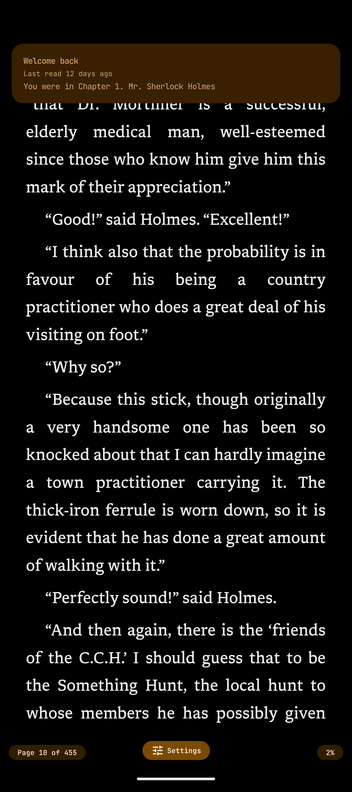 
      <strong>Lector</strong>: texto sin distracciones, con progreso y resumen al volver.
    </td>
    <td width="50%" align="center">
      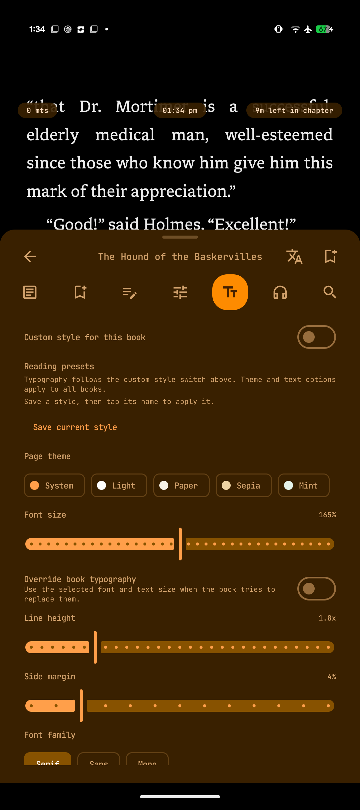 
      <strong>Controles del lector</strong>: índice, notas, progreso, estilo, lectura en voz alta y búsqueda.
    </td>
  </tr>
</table>

## Leer libros PDF

Los archivos PDF se pueden importar mediante el selector de archivos, la exploración de carpetas, Abrir con, Compartir o Reemplazar origen.

El lector PDF admite:

- Una página por pantalla, con toques de página y navegación con teclas físicas
- Navegación por el índice PDF cuando el documento lo incluye
- Navegación por número de página y posición guardada
- Ajustar a página, ajustar al ancho, zoom y desplazamiento
- Controles de brillo/luz cálida en los bordes cuando estén configurados
- Marcadores en todos los PDF
- Selección de texto, copia, diccionario, resaltados, subrayados, notas y tarjetas de citas en PDF con capa de texto
- Generación de portada a partir de la primera página y extracción de título/autor de los metadatos PDF cuando existan

Los PDF de imágenes escaneadas sin capa de texto se pueden ver, ampliar, desplazar y marcar, pero no permiten seleccionar ni buscar texto. Las fuentes y el espaciado PDF forman parte de la página, por lo que no se aplican los controles tipográficos EPUB.

## Resaltados, notas, marcadores y citas

### Durante la lectura

Selecciona texto para acceder a acciones como:

- Resaltar o subrayar
- Añadir/editar una nota
- Copiar o compartir el texto seleccionado
- Crear una tarjeta visual de cita
- Definir, buscar o traducir la selección
- Añadir etiquetas de anotación

Los resaltados EPUB superpuestos se pueden combinar. Las notas al pie pueden abrirse en ventanas emergentes si el libro lo permite.

### Biblioteca de notas

El destino global **Notas** agrupa las anotaciones por libro y muestra recuentos y fechas de actualización. Permite:

- Buscar en notas, libros y texto resaltado
- Filtrar y volver directamente al pasaje original
- Editar y compartir anotaciones
- Exportar a Markdown
- Generar cuadernos Markdown automáticos cuando estén configurados
- Importar `My Clippings.txt` de Kindle
- Importar citas de la comunidad de Goodreads, diferenciadas de las anotaciones personales
- Repasar resaltados a intervalos con **Ver pronto**, **Entendido** y **Lo sé bien**

  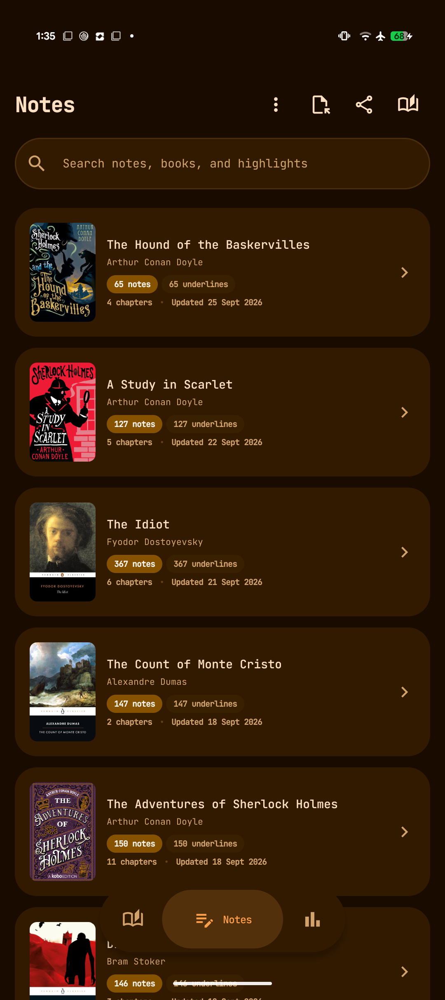 
  Las notas se agrupan por libro con recuentos de anotaciones y capítulos.

## Diccionario, traducción y vocabulario

Toca dos veces una palabra para consultarla sin conexión. Vayana prueba primero los diccionarios del idioma del libro y, bajo la definición principal, añade el significado en tus otros idiomas instalados, como el malayalam de Olam. Las consultas también encuentran posesivos, contracciones, terminaciones verbales antiguas (*canst*, *lendeth*) y palabras escritas con o sin acentos.

### Diccionarios sin conexión

Gestiona los diccionarios en **Ajustes → Texto del lector → Diccionarios**. Se prueban en el orden mostrado: usa **Probar primero …** para subir uno y el botón de papelera para quitarlo.

| Diccionario | Palabras y significados | Cómo instalarlo |
| --- | --- | --- |
| Open English WordNet | Definiciones modernas en inglés con ejemplos | **Obtener diccionario** descarga el ZIP gratuito en el navegador; luego **Instalar ZIP** |
| GCIDE (Webster’s 1913) | Inglés, incluidas palabras antiguas y literarias | El botón de descarga lo obtiene de GNU y lo prepara en el teléfono, lo que tarda unos minutos |
| Olam | Inglés → malayalam | Botón de descarga |
| FreeDict | Más de 300 diccionarios bilingües | **Más diccionarios** abre el catálogo de FreeDict, con tus idiomas primero |
| Tu propio diccionario | Cualquier diccionario StarDict | **Importar archivo StarDict** y elige el idioma de las palabras y de los significados |

Las descargas se comprueban antes de instalarse y una descarga dañada se rechaza. Cada dispositivo tiene sus propios diccionarios; no se sincronizan.

### Consulta en línea y traducción

- Busca palabras o frases seleccionadas en Wiktionary o Wikipedia cuando haya conexión a Internet.
- Envía una selección a una aplicación de traducción instalada.

La consulta en línea envía solo la consulta seleccionada al proveedor elegido cuando la solicitas. La traducción requiere una aplicación de traducción compatible.

### Aprender y vocabulario

- **Estadísticas → Palabras que buscaste → Ver todo** abre **Aprender**: cada palabra que buscaste, cuántas veces, cuándo y la frase de la que procede. Toca una palabra para ver su significado o quítala. La lista y lo que quitas se sincronizan entre dispositivos.
- Solo se guardan las consultas intencionadas: una definición que dejas abierta un momento, lees en línea o guardas. Seleccionar una palabra para empezar un resaltado no cuenta, y las palabras que ningún diccionario instalado conoce, como nombres y erratas, no se guardan.
- Oculta las palabras que ya conoces o guarda una palabra para el **repaso de vocabulario**.
- Descubre palabras poco comunes del capítulo actual y marca términos conocidos.
- Repasa el vocabulario guardado con intervalos espaciados.
- Exporta el vocabulario como CSV compatible con Anki o Markdown legible.

## Lectura en voz alta

La síntesis de voz de Android puede leer un EPUB frase por frase y continuar entre capítulos.

- Comienza desde la posición actual o un pasaje seleccionado.
- Sigue la marca de la palabra/frase pronunciada en el texto.
- Elige un motor TTS instalado, idioma, voz, velocidad y tono.
- Enséñale nombres: en **Leer en voz alta → Pronunciaciones de este libro** escribes cómo debe sonar una palabra o frase. Las correcciones se guardan en el dispositivo.
- Las pausas siguen los párrafos, títulos y cambios de escena. Los números romanos en etiquetas como *Capítulo IV* se leen como números, y las voces en inglés reciben además indicaciones para fechas, horas, importes y medidas.
- La escucha continúa con la pantalla apagada y cuenta como tiempo de lectura; Estadísticas muestra cuánto escuchaste.
- Usa un temporizador de apagado.
- Pausa tocando el lector.
- Controla la reproducción desde las notificaciones, pantalla de bloqueo, auriculares o controles Bluetooth.
- El foco de audio pausa o reduce el volumen cuando otra aplicación necesita reproducir sonido.
- El widget Continuar leyendo puede iniciar o pausar la lectura en voz alta del libro que muestra.

Las voces y los idiomas disponibles dependen de los motores TTS instalados. La lectura en voz alta está pensada principalmente para texto reajustable, no para PDF escaneados.

## Búsqueda

La búsqueda global puede encontrar:

- Títulos, autores, descripciones, series, etiquetas y otros metadatos
- Nombres de capítulos EPUB y texto de libros indexado
- Resaltados y notas personales
- Consultas recientes y coincidencias por prefijo

Pon una frase entre comillas dobles, como `"river boat"`, para que las palabras aparezcan juntas y en ese orden. Los chips de **libro** y **estantería** bajo el cuadro de búsqueda limitan los resultados a un libro o una estantería, y los chips de resultados alternan entre Todo, Libros, Notas y Contenido.

El contenido EPUB disponible localmente se indexa para buscar con rapidez. El texto de las páginas PDF y el contenido de los libros físicos no se indexan, aunque sus anotaciones personales sí pueden aparecer en la búsqueda de anotaciones.

## Estadísticas y objetivos

Elige **Semana**, **Mes**, **Año** o **Todo** en la parte superior de Estadísticas. La tarjeta principal muestra el tiempo leído en ese periodo y su comparación con el mismo punto del periodo anterior, junto con sesiones, días de lectura y libros terminados. El gráfico puede mostrar barras o una línea; el pequeño chip de la esquina de la tarjeta cambia entre ambos y Vayana recuerda la elección. Toca una barra para ver su tiempo. **Todo** muestra los últimos 12 meses, incluidos los meses sin lectura.

Las tarjetas de abajo se agrupan así:

- **Lectura:** racha y objetivo diario, **Cuándo lees** (hora del día, día de la semana y sesión media y más larga), **Escuchado y leído**, **Lo más leído**, **Dispositivos**, actividad de lectura y ritmo para terminar el libro actual
- **Libros:** **El año en libros** con **Ver tu año**, un resumen del año para compartir; registros de lectura; hábitos de lectura; autores y series; y etiquetas según el tiempo de lectura
- **Notas y palabras:** un resaltado para volver a ver, notas y resaltados, **Palabras que buscaste**, crecimiento del vocabulario y repaso de vocabulario
- **Biblioteca:** totales de la biblioteca, progreso medio y almacenamiento usado por libros, portadas, notas/citas, diccionarios, fuentes y caché

**Dispositivos** muestra el tiempo de lectura por dispositivo sincronizado y el más usado. Cada sesión guarda el nombre de sincronización del dispositivo en el que se leyó. Con la [sincronización con GitHub](#github-sync), las sesiones anteriores se asignan una sola vez a partir del historial del repositorio la próxima vez que el dispositivo esté en Wi‑Fi; el tiempo que no se puede asignar se muestra como no incluido.

**Registros de lectura** muestra los libros con actividad de lectura guardada, incluidos libros físicos aún en curso. Cada entrada muestra portada, título, autor, fechas registradas de inicio y fin y el tiempo de lectura acumulado. Toca una entrada para abrir los detalles del libro; usa **Ver todos los registros de lectura** cuando haya más de tres libros. Las fechas que faltan aparecen como **Sin registrar**. El tiempo procede de las sesiones guardadas; una fecha de fin no estima el tiempo de lectura.

Las estadísticas se basan en la actividad registrada por Vayana. Las sesiones de otro dispositivo pueden contribuir después de sincronizarse. Los objetivos diarios de minutos y anuales de libros se fijan en los ajustes de objetivos de lectura.

  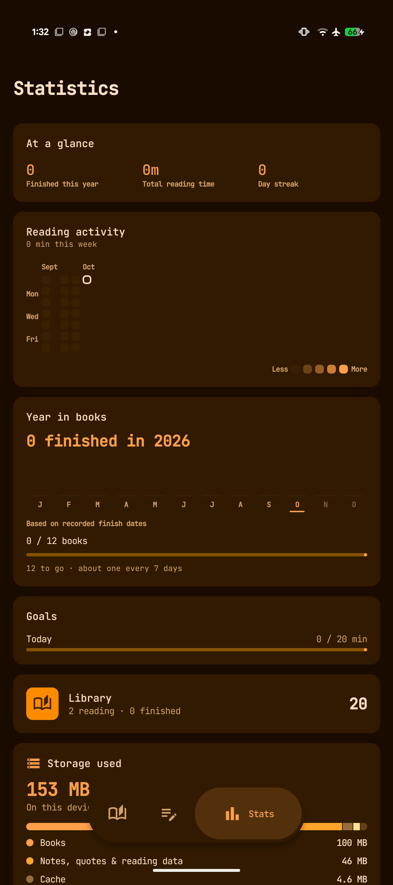 
  Actividad de lectura, objetivos, totales de biblioteca y uso de almacenamiento.

## Aplicación complementaria Wear OS

La aplicación complementaria registra la lectura de libros físicos en Wear OS 3+, con Google Play Services y un teléfono Android vinculado. Configúrala con compilaciones actuales compatibles del teléfono y del reloj siguiendo la [guía de Wear OS](WEAR_OS.md#install-and-build).

1. Añade un libro físico en el teléfono y márcalo como lectura actual.
2. Abre Vayana en el reloj y elige **Sincronizar con el teléfono** (Sync with phone) para guardar tus libros en caché.
3. Selecciona un libro, comprueba la página inicial y toca **Iniciar temporizador** (Start timer). Los temporizadores del reloj, las pausas y la edición de páginas funcionan sin conexión.
4. Toca **Detener** (Stop), introduce la página final y pulsa **Guardar** (Save). Cancelar deja en pausa un temporizador iniciado en el reloj.
5. Vuelve a conectar para enviar las sesiones guardadas al historial y las estadísticas del teléfono. Las sesiones pendientes permanecen en el reloj hasta recibir confirmación.

Un temporizador en ejecución en el teléfono también puede aparecer en el reloj, donde puedes pausarlo, reanudarlo, detenerlo y actualizar su página. Las acciones remotas esperan la confirmación del dispositivo responsable; ver un temporizador sin conexión no confirma que se haya aplicado una orden. El teléfono también permite controlar un temporizador iniciado en el reloj.

Usa **Objetivos de lectura** (Reading goals) para fijar un objetivo diario o recordatorio de sesión, y **Vibración** (Vibration) para la respuesta háptica. La aplicación incluye una pantalla ambiental, una tarjeta de lectura y una complicación para la esfera. Para conflictos de página, revisión de solapamientos, recuperación tras reinicio e indicadores de conexión, consulta la [guía completa de la aplicación complementaria](WEAR_OS.md).

El reloj no abre archivos de libros electrónicos. La conexión con el teléfono usa Data Layer de Google, independientemente de la sincronización opcional con GitHub.

## Widgets y accesos directos

Vayana ofrece dos widgets configurables para la pantalla de inicio:

- **Continuar leyendo** muestra el libro actual, su portada, el progreso y el regreso a la lectura con un toque. Si la lectura en voz alta está activada, puede mostrar reproducción/pausa.
- **Tiempo de lectura** muestra los minutos de hoy y un gráfico adaptable de siete días con un promedio.

La pantalla de configuración del widget permite previsualizar los cambios y aplica opciones compartidas de radio de esquinas y estilo de progreso a los widgets de Vayana. El diseño se adapta al tamaño elegido en el lanzador.

Mantén pulsado el icono de Vayana en el lanzador para acceder a:

- Libros gratuitos
- Búsqueda
- Estadísticas

## Copias de seguridad y restauración

### Copia manual

Abre **Ajustes → Copia de seguridad y restauración** para crear un ZIP portable con la base de datos de la biblioteca, los ajustes, los archivos de libros gestionados por Vayana, las portadas y los datos de lectura relacionados.

### Copia automática

Elige una carpeta, una frecuencia y cuántas copias conservar. Las frecuencias disponibles son diaria, cada siete días y cada 30 días. Android puede retrasar el trabajo en segundo plano según las restricciones de batería y del dispositivo.

### Restaurar de forma segura

Vayana muestra un resumen antes de restaurar: fecha de creación, versión de la aplicación, número de libros, número de anotaciones y tamaño. La restauración sustituye la biblioteca y los ajustes actuales del dispositivo y reinicia la aplicación. Crea antes una copia nueva si aún puedes necesitar la biblioteca actual.

Las copias de seguridad son independientes de la sincronización con GitHub: una copia es un archivo portable de un momento concreto; la sincronización combina los datos compatibles entre dispositivos configurados.

## Sincronización con GitHub

La sincronización con GitHub usa un repositorio bajo tu control. Puede sincronizar:

- Libros, portadas y metadatos de la biblioteca
- Posición de lectura, sesiones y fechas
- Resaltados, notas, estanterías y Próximas lecturas
- Vocabulario, palabras consultadas y ajustes portables
- Libros de Home Library y sus datos de lectura
- Eliminaciones y restauraciones

Los archivos de libros y portadas se cifran con AES-GCM usando la frase de contraseña de sincronización antes de subirse. El token de GitHub se almacena en el dispositivo. La sincronización ligera del progreso puede ejecutarse mientras lees, y la sincronización completa concilia el estado de la biblioteca y sus archivos. Solo se sube lo que ha cambiado: una sincronización sin novedades tarda alrededor de un segundo, y **Ajustes → Ayuda e información → Uso de datos** muestra lo que envió y recibió cada sincronización.

Todos los dispositivos que comparten un repositorio necesitan Vayana 0.93 o posterior: las versiones anteriores no pueden leer su formato de sincronización compacto.

Reglas importantes de configuración:

- Usa un repositorio privado dedicado a la sincronización de Vayana.
- Concede al token solo el acceso al repositorio que necesita.
- Usa el mismo repositorio, rama y frase de contraseña en todos los dispositivos.
- Asigna a cada dispositivo un nombre reconocible para los mensajes de conflicto e historial y la tarjeta **Dispositivos** de Estadísticas.
- Guarda la frase de contraseña en un lugar seguro; sin ella no se pueden recuperar los archivos cifrados.
- Usa **Probar conexión con GitHub** antes de la primera sincronización completa.

Consulta [Configurar la sincronización con GitHub](GITHUB_SYNC_SETUP.md) para ver el procedimiento completo y la lista de comprobaciones para resolver problemas.

## E-Ink y accesibilidad

### Perfil de pantalla E-Ink

E-Ink es un perfil específico, no un simple tema en escala de grises. Puede:

- Eliminar o reducir el movimiento y la animación al pasar página
- Mostrar el progreso de forma estática
- Ofrecer paletas **Monocroma** y **Color** de alto contraste
- Vincular las actualizaciones del lector a los cambios de página cuando sea posible
- Usar teclas físicas de página
- Añadir controles para avanzar una pantalla cada vez en pantallas largas
- Solicitar actualizaciones de limpieza del lector a intervalos y transiciones configurados
- Ofrecer controles de texto más grueso, alineación y separación con guiones

Actualmente no se integran API de actualización específicas de fabricantes, por lo que el comportamiento depende del dispositivo Android y de su propio modo de actualización.

### Accesibilidad y diseño adaptable

- Los componentes Material 3 ofrecen descripciones de contenido y texto escalable.
- El movimiento puede configurarse como Completo, Reducido o Desactivado.
- Hay apariencias estándar, oscura suave y negro puro.
- Los diseños de teléfono y tableta adaptan la navegación y el ancho del contenido.
- El texto, los márgenes, el contraste y el interlineado del lector se pueden ajustar por separado.

## Ajustes e idiomas

Los ajustes están agrupados y permiten búsquedas:

- **Apariencia:** tema, colores, E-Ink, movimiento, navegación, fechas e idioma de la aplicación
- **Biblioteca:** pantalla inicial, portadas, comportamiento al terminar, libros sin archivo digital, Home Library, recordatorios y Eliminados recientemente
- **Texto del lector:** fuente, tamaño, espaciado, estilos del libro, fuentes personalizadas y diccionarios sin conexión
- **Página del lector:** colores de página, márgenes, encabezado, pie y presentación del progreso
- **Controles del lector:** toques, teclas, resaltado, mantenimiento de pantalla encendida, lectura en voz alta y controles relacionados
- **Objetivos de lectura:** minutos diarios, libros anuales e inicio de semana
- **Sincronización:** repositorio GitHub, credenciales, frase de contraseña, nombre del dispositivo, estado, pruebas y transferencia
- **Copia de seguridad y restauración:** copias manuales y programadas
- **Ayuda e información:** ayuda integrada, Diagnóstico, Privacidad y datos, Uso de datos, versión, código fuente, enlace a la versión, compartir y enlaces del desarrollador

El idioma de la interfaz de Vayana se puede elegir independientemente del idioma de los libros. La versión 0.93 incluye inglés, español, portugués, ruso, alemán, francés, italiano, malayalam y tamil. Busca **Idioma** en Ajustes para cambiar el idioma de la aplicación; los libros conservan sus propios metadatos de idioma.

  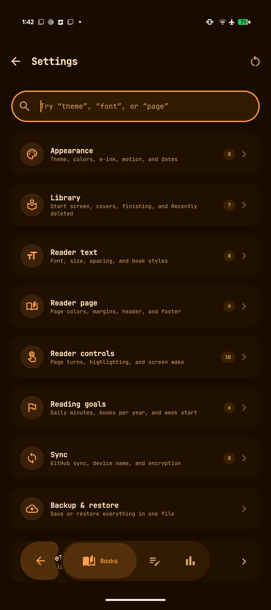 
  Los grupos de ajustes con búsqueda separan las opciones globales de las específicas del lector.

## Diagnóstico y soporte

Abre **Ajustes → Ayuda e información → Diagnóstico** cuando la aplicación se cierre inesperadamente o la sincronización no se comporte como esperas.

Diagnóstico registra localmente cierres inesperados no controlados y problemas recientes de sincronización. Una sincronización que solo falla porque el dispositivo no tiene conexión no se registra como problema. La pantalla muestra recuentos, eventos del más reciente al más antiguo y detalles técnicos desplegables. También ofrece:

- **Compartir con el desarrollador** para abrir el panel de compartir de Android con un informe de texto
- **Copiar informe** para colocarlo en el portapapeles
- **Borrar todos los registros** para eliminar del dispositivo los eventos de diagnóstico guardados

El informe generado incluye versión de la aplicación, versión de Android, modelo del dispositivo, horas de los eventos, orígenes, mensajes y trazas técnicas. No incluye contenido privado de libros, notas ni ajustes. Se ocultan valores de autorización habituales, parámetros secretos de URL, patrones de tokens GitHub, rutas de usuario, rutas de archivos externos, URI de contenido y direcciones de correo electrónico. Revisa siempre el informe antes de compartirlo.

Al informar de un problema, incluye:

- Qué estabas haciendo
- Qué esperabas
- Qué ocurrió en su lugar
- Si sucede siempre
- El formato del libro y si afecta a uno o a todos los libros
- El informe de diagnóstico, si corresponde

Nunca publiques un token GitHub ni la frase de contraseña de sincronización en una incidencia.

<table>
  <tr>
    <td width="50%" align="center">
      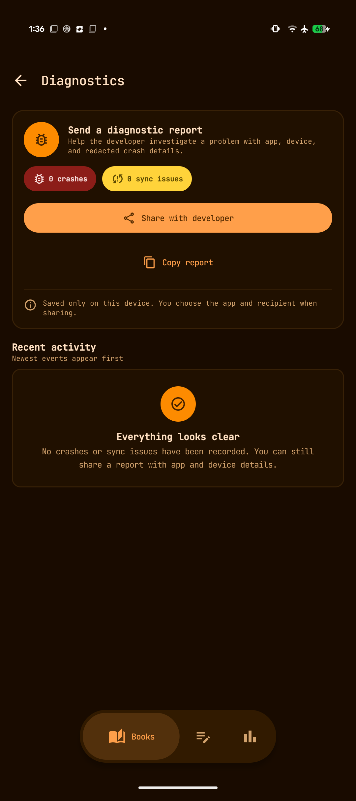 
      <strong>Diagnóstico</strong>: revisa y comparte información de cierres inesperados o sincronización con datos sensibles ocultos.
    </td>
    <td width="50%" align="center">
      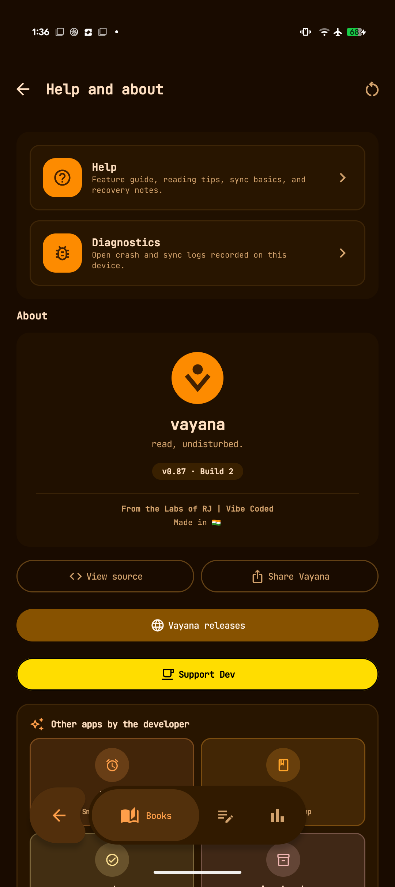 
      <strong>Acerca de</strong>: versión, código fuente, versiones publicadas, soporte, compartir y enlaces del desarrollador.
    </td>
  </tr>
</table>

Informa de problemas reproducibles mediante [GitHub Issues](https://github.com/rjwarrier/Vayana/issues).

## Privacidad y servicios en línea

La lectura básica, búsqueda local, notas, los diccionarios sin conexión instalados, estadísticas y copias locales funcionan sin una cuenta Vayana.

**Ajustes → Ayuda e información → Privacidad y datos** muestra dónde se guardan tus datos en el dispositivo, qué sale de él y hacia quién, y el estado actual del cifrado del dispositivo, el bloqueo de pantalla y la visibilidad del repositorio de sincronización. **Uso de datos**, a su lado, muestra los datos Wi‑Fi y móviles de Vayana por día y lo que envió y recibió cada sincronización; estos registros se quedan en el dispositivo.

Se accede a la red cuando eliges o configuras una función en línea:

| Función | Datos implicados |
| --- | --- |
| Project Gutenberg | Solicitudes de búsqueda/filtro y descargas de libros |
| OPDS | Dirección del catálogo, solicitudes de navegación/búsqueda, autenticación opcional del servidor y descargas |
| Goodreads | Consulta de metadatos/portadas de libros y alternativa mediante navegador |
| Wiktionary/Wikipedia | La palabra o frase seleccionada cuando solicitas una consulta |
| Descargas de diccionarios | Descargas desde Open English WordNet, GNU (GCIDE), Olam o FreeDict cuando instalas un diccionario; las consultas sin conexión se quedan en el dispositivo |
| Traducción | Texto seleccionado enviado a la aplicación/proveedor de traducción elegido |
| Sincronización con GitHub | Metadatos de sincronización y archivos de libros/portadas cifrados con AES-GCM; los identificadores del repositorio y el token permanecen en los ajustes de la aplicación en el dispositivo |
| Búsqueda de portadas | Metadatos de búsqueda del libro necesarios para la fuente elegida |

Los registros de diagnóstico permanecen en el dispositivo hasta que los copies, compartas o borres explícitamente. La aplicación receptora elegida en Android controla qué ocurre después de compartirlos.

## Solución de problemas

### Un libro no se importa

- Confirma que sea un EPUB o PDF válido y que otro lector pueda abrirlo.
- Los PDF protegidos con contraseña no son compatibles.
- Si Android indica un tipo de archivo genérico, conserva la extensión `.epub` o `.pdf`.
- Prueba el selector de archivos de Vayana en lugar de Compartir/Abrir con.
- Comprueba el almacenamiento disponible y concede acceso al archivo o carpeta elegidos.

### Falta un libro después de mover archivos

- Abre Detalles del libro y usa **Reemplazar origen** para volver a vincular el registro.
- Si se eliminó permanentemente de Vayana, vuelve a importar el archivo.
- Consulta **Eliminados recientemente** si se borró hace poco y restáuralo desde allí.

### Project Gutenberg u OPDS no carga

- Comprueba la conexión a Internet y vuelve a intentarlo.
- Project Gutenberg puede responder lentamente; Vayana puede mostrar el catálogo guardado sin conexión.
- En OPDS, verifica la URL exacta del catálogo y que el servidor sea accesible.
- Si falla la autenticación, comprueba las credenciales del servidor fuera de Vayana.

### El diccionario o la traducción no están disponibles

- Instala un diccionario para el idioma del libro en **Ajustes → Texto del lector → Diccionarios**.
- Confirma que el idioma del libro sea correcto en los metadatos.
- Si responde primero el diccionario equivocado, cambia allí el orden.
- La alternativa Wikimedia requiere acceso a Internet.
- La traducción requiere una aplicación compatible.

### La lectura en voz alta no tiene voz

- Instala o activa un motor TTS de Android y la voz del idioma necesario.
- Comprueba el volumen multimedia y la salida Bluetooth.
- Revisa el motor, la voz, el idioma, la velocidad y el tono en los ajustes de lector/audio.
- En dispositivos E-Ink, confirma que **Funciones de audio** esté activado.

### Falla la sincronización con GitHub

- Abre **Ajustes → Sincronización** y ejecuta **Probar conexión con GitHub**.
- Confirma propietario, repositorio, rama, token y frase de contraseña.
- Asegúrate de que el token tenga acceso al repositorio configurado.
- Usa la misma frase de contraseña en todos los dispositivos.
- Abre Diagnóstico y comparte el evento de sincronización con datos sensibles ocultos si el error sigue sin estar claro.

### Las estadísticas parecen incompletas

- Solo se cuentan las sesiones registradas por Vayana.
- Confirma que el libro se abra mediante Vayana y que el reloj del dispositivo sea correcto.
- Ejecuta la sincronización si la actividad se registró en otro dispositivo configurado.
- Si falta un dispositivo en la tarjeta **Dispositivos**, da a cada uno su propio nombre en **Ajustes → Sincronización** y vuelve a sincronizar.

### La aplicación se cerró inesperadamente

1. Vuelve a abrir Vayana.
2. Ve a **Ajustes → Ayuda e información → Diagnóstico**.
3. Despliega el cierre inesperado más reciente y confirma que la hora coincida.
4. Usa **Compartir con el desarrollador** o **Copiar informe**.
5. Describe la acción realizada inmediatamente antes del cierre.

## Limitaciones actuales

- Los formatos digitales de lectura compatibles son EPUB y PDF.
- Los PDF escaneados sin capa de texto no permiten selección, consultas, búsqueda ni anotaciones de texto.
- La tipografía PDF está fijada por el documento; no se aplican los controles de fuente y espaciado EPUB.
- La compatibilidad PDF no incluye actualmente todas las funciones exclusivas de EPUB, como lectura biónica o citas de la comunidad.
- Los PDF protegidos con contraseña no son compatibles.
- El contenido de los libros físicos y el texto de las páginas PDF no forman parte de la indexación del libro completo.
- No están integrados los SDK de actualización E-Ink específicos de fabricantes.
- El historial Git puede conservar archivos cifrados en commits antiguos de sincronización tras una eliminación permanente en la nube, salvo que se reescriba el historial del repositorio.
- Las funciones de catálogos, enriquecimiento, consultas, traducción y sincronización en línea dependen de la disponibilidad de servicios de terceros.

## Documentación relacionada

- [Comportamiento de las funciones y detalles de implementación](FEATURES.md)
- [Configuración de sincronización con GitHub](GITHUB_SYNC_SETUP.md)
- [Decisiones de arquitectura e implementación](DECISIONS.md)
- [Registro de cambios de la base de datos](DATABASE_CHANGELOG.md)
- [Versión 0.93 de Vayana](https://github.com/rjwarrier/Vayana/releases/tag/v0.93)
